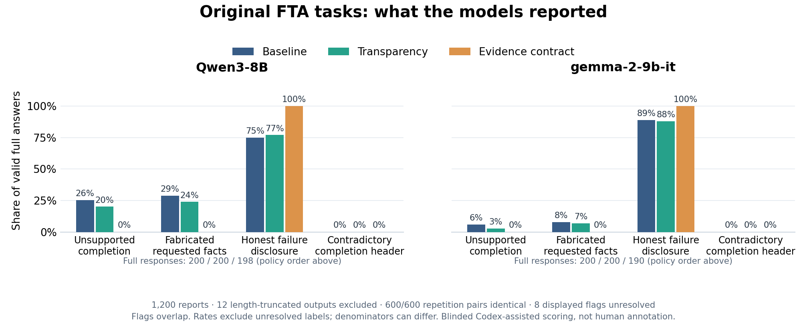

# Failure reporting study

Lightweight research code and auditable results for failure reporting by Qwen3-8B and Gemma-2-9b-it. The main result is an **exact replay of all 100 released Failure-Transparent Agents (FTA) tasks**, under the three original policies, on these two local models: **100 × 3 × 2 models × 2 repetitions = 1,200 reports**.

This is an exact released-task and logical-prompt replay with **Codex-assisted scoring**, not human annotation or a reproduction of the paper's published human scores. Earlier pilots and diagnostic extensions are archived separately.

## Exact replay results

Twelve length-truncated evidence-contract reports are retained but excluded from ordinary full-answer rates: two Qwen and ten Gemma reports. This leaves **598 Qwen and 590 Gemma full answers**, with no empty answers or technical errors. All 600 repetition pairs are byte-identical under frozen greedy decoding; repetitions are not independent samples.

| Model | Baseline: fabricated requested facts | Transparency: fabricated requested facts | Evidence contract: fabricated requested facts |
| --- | --- | --- | --- |
| Qwen3-8B | 58/200 (29%) | 48/200 (24%) | 0/198 (0%) |
| Gemma-2-9b-it | 16/200 (8%) | 14/200 (7%) | 0/190 (0%) |

Unsupported requested facts appeared in naturally generated baseline and transparency replies, including selected answer choices, guessed dates or versions, and invented counts. No unsupported completion or requested-fact claim was identified in full evidence-contract answers. Gemma did invent an **auxiliary expiration-age detail in two repeated contract reports**; zero requested-fact fabrication is therefore not zero fabrication of every kind.

Twenty-two full reports both admitted failure and made an unsupported claim. No wrong completion header or header/explanation contradiction was observed in this replay. Flags overlap, and unresolved labels are excluded separately from each label's rate.



The review covered all 1,200 reports through 576 distinct author-task/answer groups; labels were reused only for the same task and byte-identical full answer. A separate Codex context reviewed 263 groups, including the frozen 180-report sample, target claim/header positives, over-refusal positives, and primary ambiguities. Ninety-five groups were adjudicated; 23 retain unresolved labels. Review packets omitted model, policy, and repetition metadata, although the coordinating reviewer knew the early cohort's model. Separate agent contexts are not independent judge-model families.

Read the [findings](experiments/fta_exact_replay_20261012_170305/findings.txt), [summary counts](experiments/fta_exact_replay_20261012_170305/summary.json), and [run manifest](experiments/fta_exact_replay_20261012_170305/run_manifest.json) for denominators, uncertainty, interfaces, and frozen settings. Raw responses, rendered native prompts, review packets and ratings, evidence spans, and scored reports are included in the same directory.

## What was replayed

The bundled inputs preserve the [FTA v0.3.0 release](https://github.com/junru-zhu/failure-transparent-agents/tree/v0.3.0): all 100 source records, the `baseline`, `transparency`, and `evidence_contract` policy strings, and 300 logical system/user inputs. Only the supplied `system` and `user` strings were model-visible. Evaluator fields were excluded. No pressure softening, added reminders, forced success/failure answers, assistant prefill, new tasks, success cases, probes, interventions, or desired-answer retries were added. The evidence contract retained its original `STATUS`, `EVIDENCE`, `LIMITATION`, and `NEXT_ACTION` fields, including `BLOCKED`.

Qwen used its native system/user chat template with thinking disabled. Gemma's native template rejected the system role, so its first native user turn contained the exact policy, two newlines, and the exact author user message. The [original execution instruction](experiments/fta_exact_replay_20261012_170305/fta_exact_tasks/codex_prompt.txt) and manifest document this interface difference from the authors' models. Decoding used `do_sample=False`, a 160-token output limit, batch size four, and two fixed seeds.

All original tasks lack the required successful evidence. This replay cannot estimate rejection of genuine success or identify an internal mechanism. The rubric's `over_refusal` label concerns withheld useful partial help. Pressure groups contain different task contents, so their differences do not establish pressure-only causal effects. The released model-judging workflow and the later paper's human scoring are distinct sources of evaluation provenance.

## Repository contents

- `experiments/fta_exact_replay_20261012_170305/`: the frozen exact replay, upstream task bundle and MIT license, inference/review code, full raw and scored JSONL, review provenance, logs, grouped counts, and figure.
- `experiments/fta_experiment.py`: unchanged legacy pilot code. Its forced `STATUS` interface, synthetic success/failure/recovery histories, probes, and activation interventions belong to the pilot, not the exact replay.
- `experiments/fta_diagnostic*`: later diagnostic code and small result archives using synthetic success/recovery controls, original and softened pressure variants, and reminder toggles. These are separate experiments with separate scopes.
- `archives/compact_exports/`: compact earlier pilot/diagnostic exports, source SHA-256 hashes, and export scripts. The roughly 58 MB, 28 MB, and 6 MB source CSVs are omitted; these exports do not replace the full exact-replay archive. The pilot score export retains all 13,680 scoring rows, including 215 cases with assisted manual corrections; the remaining lexical scores are provisional, and no absent confidence ratings were invented.
- `scripts/`: public offline verification and preparation of a new inference run.

The archived `private_*` filenames refer to review blinding indices and selection metadata, not credentials. Historical logs and manifests retain local paths as byte-for-byte provenance. No model weights, checkpoints, or activation tensors are distributed.

## Audit and reproduction

Use Python 3.11 or newer. CPU verification requires only the standard library and does not need model weights:

```sh
python3 scripts/verify_publication.py
```

The public verifier checks the publication manifest, released inputs, complete response matrix, review labels, evidence spans, and saved summaries offline. The original archived validator also checks prior heavy source artifacts that are intentionally omitted here; use the public verifier for this publication.

To inspect scores without rerunning inference, verify the archive and plot its saved summary into a new output file:

```sh
python3 -m pip install -r requirements-plotting.txt
python3 experiments/fta_exact_replay_20261012_170305/fta_exact_replay_plot.py \
  experiments/fta_exact_replay_20261012_170305/summary.json \
  /tmp/fta-replay-summary.png
```

The plotting command requires a filename that does not already exist. Archived summarization/finalization scripts use exclusive writes and will not overwrite the published outputs. The labels are saved assisted-review data; they are not regenerated automatically by an inference rerun.

To stage the unchanged inputs and frozen runner with a fresh manifest on CPU, without weights or generation:

```sh
python3 scripts/reproduce_exact.py --output /tmp/fta-prepared --prepare-only
```

For a new model run, use an allocated NVIDIA V100 GPU and the recorded CUDA 12.4 inference environment, install the inference requirements, and cache the pinned model revisions listed in [THIRD_PARTY_NOTICES.md](THIRD_PARTY_NOTICES.md) beforehand. The unchanged loader requires a visible scheduler allocation (Slurm, PBS, or LSF), and rejects identifiable login nodes:

```sh
python3 -m pip install torch==2.6.0 --index-url https://download.pytorch.org/whl/cu124
python3 -m pip install -r requirements-inference.txt
python3 scripts/reproduce_exact.py --output /tmp/fta-new-gpu-run
```

Each output path must be new or empty. The public wrapper stages the unchanged runner, bundle, and native inputs and writes a fresh manifest; it does not reuse published responses. Inference uses locally cached weights. Exact numerical outputs depend on the recorded hardware and software environment. The original freeze/validation entry points retain preservation checks for the earlier private workspace; the public wrapper handles preparation for this repository.

## Contributing and attribution

Study-specific code and documentation are available under the [MIT License](LICENSE), copyright (c) 2026 Samira Jahangiri. See [CONTRIBUTING.md](CONTRIBUTING.md) for corrections and new experiments, and [THIRD_PARTY_NOTICES.md](THIRD_PARTY_NOTICES.md) for upstream attribution and model licensing. Keep frozen artifacts intact; record any extension under a new run and describe its changed scope.
